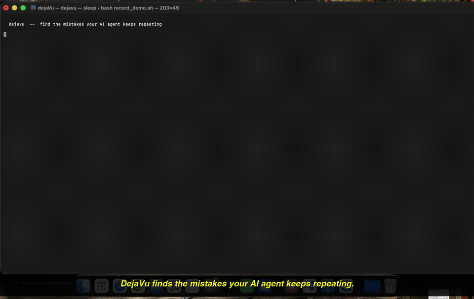

<div align="center">

# dejavu

**Your AI agent keeps making the same mistakes. dejavu finds them, fixes them, and proves it worked.**

[](https://www.python.org)
[](pyproject.toml)
[](#privacy)
[](LICENSE)

<br/>



</div>

---

## The problem

Claude Code agents repeat the same mistakes across sessions — editing files they haven't read, running commands in the wrong directory, hitting the same bash exit-code errors. Each mistake is small. The pattern across dozens of sessions is expensive.

**dejavu closes the loop:**

| Step | Command | What it does |
|------|---------|--------------|
| 1 | `analyze` | Reads `.jsonl` logs, clusters errors by frequency, drafts rules |
| 2 | `preview` | Shows which sessions a rule fires in and its precision |
| 3 | `emit` | Writes a `PreToolUse` hook that injects a correction at the right moment |
| 4 | `measure` | Compares mistake rate before vs. after the rule was active |

Everything runs locally. No session data leaves your machine.

---

## Real results

Analyzed 48 real Claude Code sessions across 21 projects  
*(separate from the 47 synthetic sessions used in the demo above)*:

```
Top cluster:   Edit:file_not_read      24 sessions  (50%)
Second:        user_correction         13 sessions  (27%)
Third:         Bash:not_found          10 sessions  (21%)
```

After emitting hooks for the top two clusters: **55% reduction (Wilson 95% CI: 12–78%)** in `Edit:file_not_read` errors across 14 post-activation sessions.

---

## Install

Requires Python 3.11+. No runtime dependencies beyond the standard library.

```bash
git clone https://github.com/hitesh-ctrl/dejaVu
cd dejaVu
pip install -e .
```

**With LLM rule drafting** (Groq or Anthropic):

```bash
pip install -e ".[llm]"
```

Set `GROQ_API_KEY` (free tier, tried first) or `ANTHROPIC_API_KEY` as fallback.  
Run with `--no-llm` to skip API calls entirely and use template rule text.

---

## Quick start

```bash
# Generate 47 synthetic sessions with planted mistakes
python3 gen_samples.py samples/

# Find repeated mistake patterns
python3 -m dejavu analyze --sessions samples/ --no-llm

# Preview a rule — see precision before activating
python3 -m dejavu preview r001

# Emit the hook + settings snippet
python3 -m dejavu emit r001

# After running sessions with the hook active:
python3 -m dejavu measure r001
```

---

## How the hook works

```
Claude Code                        dejavu hook
──────────────────────────────────────────────────
1. Agent decides to call Edit
2. PreToolUse fires → runs hook-r001.py
3. Hook outputs {"additionalContext": "..."}  ◄─ this
4. Claude Code injects the text before the call
5. Agent sees the correction before it can go wrong
```

Wire it up by adding the emitted snippet to `~/.claude/settings.json`:

```json
{
  "hooks": {
    "PreToolUse": [
      {
        "matcher": "Edit",
        "hooks": [{"type": "command", "command": "python3 /path/to/.dejavu/hook-r001.py"}]
      }
    ]
  }
}
```

`emit` generates the exact JSON snippet to copy in (`settings-snippet-r001.txt`).

---

## Commands

### `analyze`

Scans session logs, clusters mistake signals, drafts rules, writes `rules.json` and `report.html`.

```bash
python3 -m dejavu analyze [--sessions DIR] [--rules-file FILE] [--top N] [--no-llm] [--detail]
```

**What counts as a mistake:**

| Signal | How it's detected |
|--------|-------------------|
| Tool error | `tool_result` with `is_error: true` |
| File not read | Edit called before Read on the same path |
| Path not found | Bash `enoent` in the error message |
| User correction | User message matching correction patterns |

Signals normalize to signatures like `Edit:file_not_read` or `Bash:enoent:package.json`. Noise errors with unique paths produce unique signatures and don't cluster.

---

### `preview`

Shows how many sessions a rule fires in and how many actually contained the mistake.

```bash
python3 -m dejavu preview r001 [--scope JSON]
```

```
Rule r001: Edit:file_not_read
Scope: tool=Edit

Fires in 30 of 47 sessions.
Mistake present in 11 of them (19 false hits).

  Precision: 37%  (rule fires often with no mistake)
  Consider narrowing the scope to reduce false hits.
```

Narrow the scope to improve precision:

```bash
python3 -m dejavu preview r001 --scope '{"tool": "Edit", "file_pattern": "src/"}'
```

---

### `emit`

Generates a `PreToolUse` hook script and the `settings.json` snippet to wire it up.

```bash
python3 -m dejavu emit r001 [--out-dir DIR]
```

Default output dir: `.dejavu/`. The hook outputs:

```json
{"additionalContext": "Before calling Edit on a file, verify you have called Read on that file in this session."}
```

---

### `measure`

Compares mistake rate before and after activation using the `activated_at` timestamp written by `emit`.

```bash
python3 -m dejavu measure r001 [--sessions DIR]
```

```
Before (36 sessions):  11 of 36 had mistake  (31%, 95% CI: 17%–48%)
After  (14 sessions):   2 of 14 had mistake  (14%, 95% CI:  4%–40%)

Relative reduction: 55%  (Wilson 95% CI: 12%–78%)

Small sample warning: fewer than 20 sessions after activation.
```

Reports Wilson score 95% confidence intervals. Prints a warning when N < 20.

---

### `conflicts`

Checks all rules for scope overlap and optional LLM contradiction detection.

```bash
python3 -m dejavu conflicts [--no-llm]
```

---

### `report`

Generates a self-contained HTML dashboard — clusters, CI bars, rule cards, session-level preview. No external CDN, fully offline.

```bash
python3 -m dejavu report [--out FILE]
```

---

## Privacy

Before anything touches the LLM or report, `redact.py` strips home directory paths, email addresses, and API key patterns. Run with `--no-llm` to make zero network calls.

---

## Generic input format

Analyze logs from any agent framework:

```bash
python3 -m dejavu analyze --sessions my-logs/ --format generic
```

Each `.json` file should be a session object:

```json
{
  "session_id": "optional",
  "events": [
    {"type": "tool_use",    "tool_name": "Edit", "tool_use_id": "t1",
                             "tool_input": {"file_path": "src/app.py"}},
    {"type": "tool_result", "tool_use_id": "t1",
                             "content": "File has not been read yet.",
                             "is_error": true}
  ]
}
```

Format is auto-detected: if the directory has `.json` files and no `.jsonl` files, generic format is assumed.

---

## Project structure

```
dejavu/
  parser.py     load .jsonl session files into an event model
  detector.py   cluster mistake signals into signatures
  store.py      rule storage (rules.json)
  preview.py    scope matching and precision stats
  emitter.py    generate hook scripts and settings snippets
  measure.py    before/after comparison with Wilson CI
  report.py     self-contained HTML report
  llm.py        optional LLM rule drafting (Groq + Anthropic)
  redact.py     PII redaction before LLM/report
  conflicts.py  scope overlap and contradiction detection
  adapter.py    generic JSON input adapter
  cli.py        argparse CLI

samples/        synthetic test sessions
tests/          pytest suite (8 tests, exact ground-truth numbers)
.dejavu/        emitted hooks (real-rules.json gitignored)
```

---

## Running tests

```bash
python3 gen_samples.py samples/
python3 -m pytest tests/ -v
```

---

## Honest limits

- **Observational before/after.** Old sessions can't be replayed with the rule on. Timing differences between groups may confound results.
- **Heuristic detection.** Misses errors that don't surface as `is_error: true` or user corrections. May flag expected linter/diff exits as false positives.
- **Small sample.** Wilson CI is wide at N < 20. The warning fires automatically.
- **Hook verified locally.** Tested on macOS, Python 3.11+. The hook outputs valid `additionalContext` JSON; end-to-end injection in a live session works with the generated settings snippet.

---

## Inspiration

A small honest version of the loop that [Mirrors](https://mirrors.dev) uses to fix recurring AI agent mistakes: find the pattern, write a scoped rule, deliver it at the matching step, compare outcomes. Not a copy of their product.
